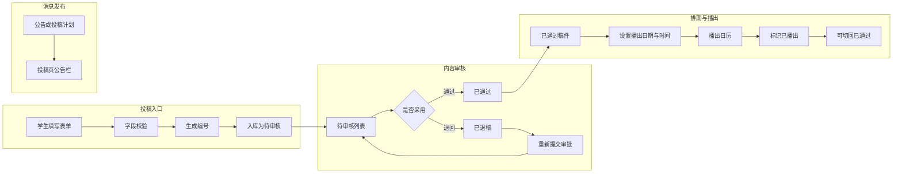
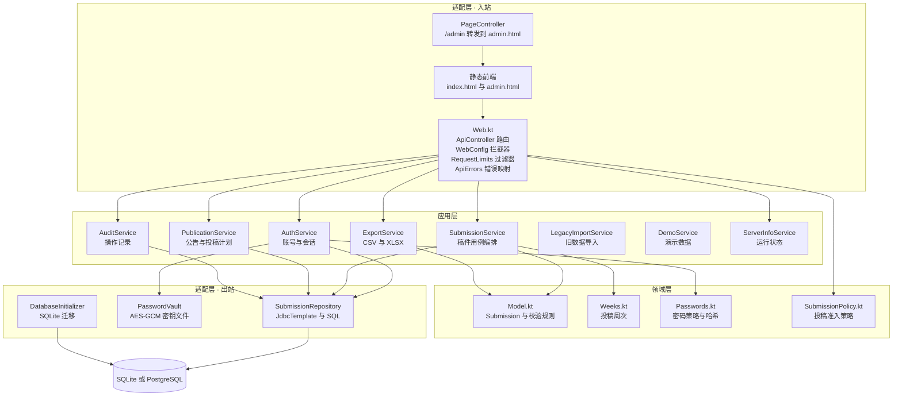
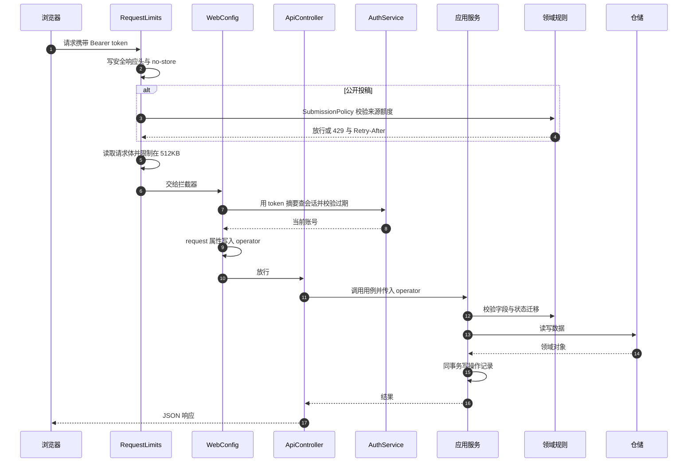
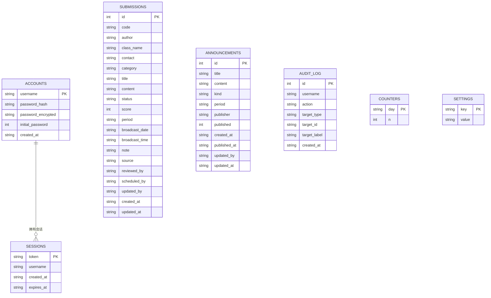
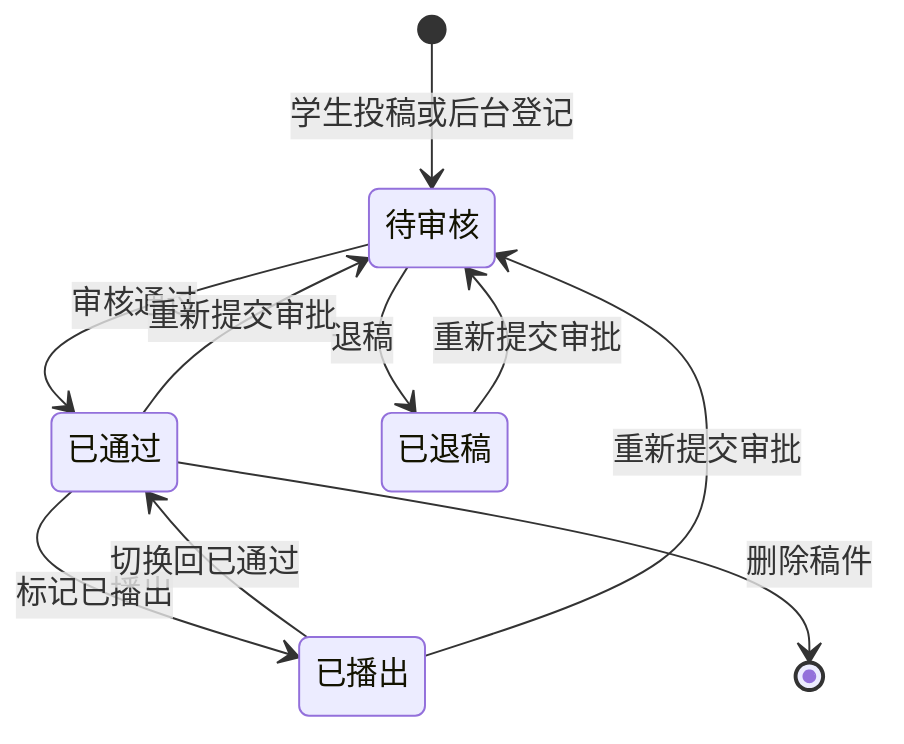
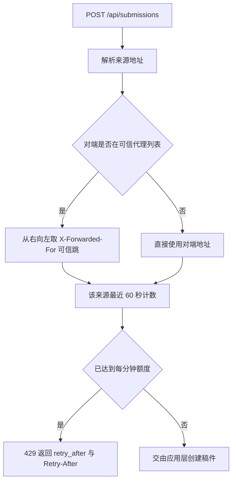
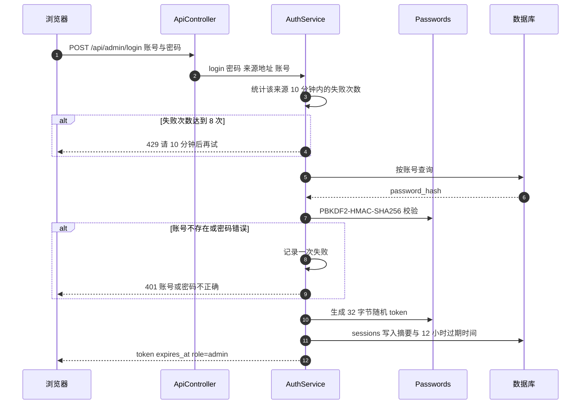
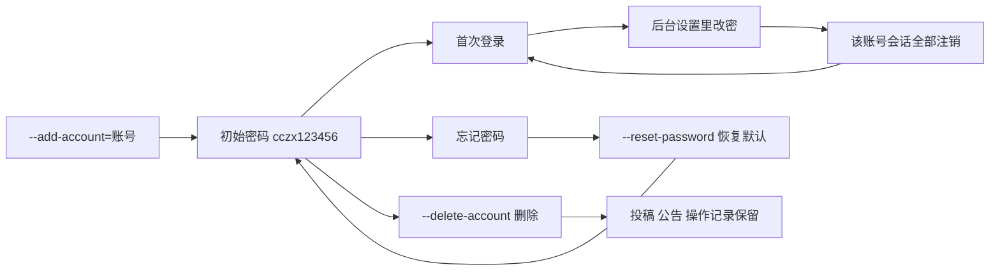
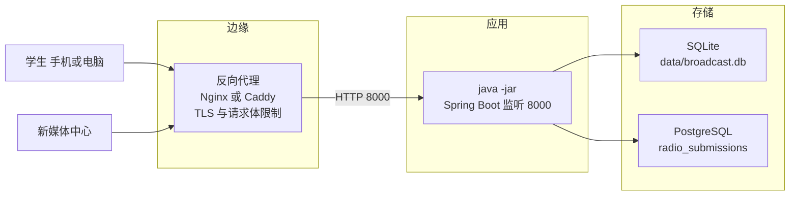
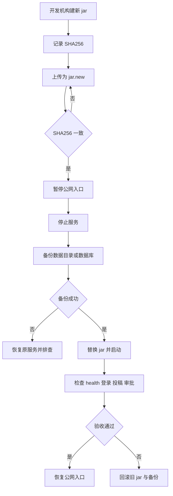

# cczx-RadioStation

长春中学新媒体中心 · 校园广播投稿系统。

学生在线提交 1–100 字稿件；新媒体中心在后台完成审批、排期、播出与公告发布。后端 Kotlin + Spring Boot，前端原生 HTML/CSS/JavaScript，单 jar 交付，默认 SQLite，可切换 PostgreSQL。

| 入口 | 地址 |
| --- | --- |
| 投稿页 | `http://<主机>:8000/` |
| 管理后台 | `http://<主机>:8000/admin` |
| 健康检查 | `http://<主机>:8000/api/health` |

> **首次部署没有任何账号**。必须先执行 `--add-account` 创建账号，否则打开后台无法登录，且页面不会提示原因。

## 目录

- [1. 项目定位](#1-项目定位)
- [2. 技术栈](#2-技术栈)
- [3. 架构分层](#3-架构分层)
- [4. 领域模型](#4-领域模型)
- [5. 认证与账号](#5-认证与账号)
- [6. 功能地图](#6-功能地图)
- [7. 快速开始](#7-快速开始)
- [8. 部署指南](#8-部署指南)
- [9. 命令与查询参考](#9-命令与查询参考)
- [10. 运维与升级](#10-运维与升级)
- [11. 注意事项](#11-注意事项)
- [12. 已知限制](#12-已知限制)
- [13. 目录结构](#13-目录结构)
- [14. 验证与测试](#14-验证与测试)

## 1. 项目定位

一套单一业务的闭环工具，不是通用 CMS。三类使用方，边界清晰：

| 使用方 | 入口 | 能力 | 账号 |
| --- | --- | --- | --- |
| 学生 / 投稿人 | 投稿页 | 提交稿件、查看公告栏、拿到编号 | 不需要 |
| 新媒体中心 | 管理后台 | 审批、退稿、排期、标记播出、评分备注、手动登记、导出、删除、发布消息、看操作记录与服务器状态 | 需要 |
| 外部程序 | REST API | 投稿、查公告、按编号+姓名查进度 | 不需要 |

**所有后台账号权限完全相同**（统一管理员），没有角色分级。

### 1.1 业务闭环



### 1.2 关键设计取舍

| 选择 | 原因 | 代价 |
| --- | --- | --- |
| 不提供网页注册 | 账号是管理权限，必须线下可控 | 只能用命令行加账号 |
| 单一级别管理员 | 校园场景人数少，避免权限模型复杂化 | 加账号等于给全套能力 |
| 默认 SQLite | 零外部依赖，一台机器即可运行 | 单写入者，不适合多实例并发写 |
| 原生前端 | 无构建链、无 npm、改完即生效 | 无组件化，页面逻辑靠手写 |
| 不内置 TLS | 证书由部署方掌握 | 公网必须自备反向代理 |

## 2. 技术栈

| 层面 | 选型 | 说明 |
| --- | --- | --- |
| 语言 | Kotlin 2.1.21 | 根包 `com.cczxcsc`，入口 `com.cczxcsc.ApplicationKt` |
| 框架 | Spring Boot 3.5.7 | Web + JDBC，内嵌 Tomcat，无 JPA、无模板引擎 |
| JVM | Java 21+ | `pom.xml` 的 `java.version=21` |
| 数据库 | SQLite（默认）/ PostgreSQL | SQLite 由代码内幂等迁移，PostgreSQL 由 Flyway V1–V4 |
| 数据访问 | `JdbcTemplate` + 手写 SQL | 全部参数化 |
| 导出 | Apache POI 5.4.1 | XLSX 双工作表；CSV 手写并做公式注入转义 |
| 前端 | 原生 HTML/CSS/JS | 无框架、无打包、由 jar 内静态资源托管 |
| 构建 | Maven（自带 `mvnw`） | 产物 `target/cczx-RadioStation.jar` |
| 容器 | Dockerfile 多阶段 + Compose | 运行镜像 `eclipse-temurin:21-jre`，非 root 用户 `10001` |

## 3. 架构分层

代码采用**领域层 / 应用层 / 适配层**三层模型，依赖方向单向：适配层 → 应用层 → 领域层，领域层不反向依赖外层。

> 当前源码在单一包 `com.cczxcsc` 下按职责分文件，三层是**逻辑分层**而非物理分包；下表给出文件到层的映射，后续要拆包可直接按此迁移。

### 3.1 分层结构



### 3.2 文件与层映射

| 层 | 文件 | 职责 | 依赖 |
| --- | --- | --- | --- |
| 领域层 | `Model.kt` | `Submission` 数据结构、栏目与状态集合、`Validation` 字段规则、`ApiError` | 仅 `java.time` |
| 领域层 | `Weeks.kt` | ISO 周次值对象、开放周次、周次解析 | 仅 `java.time` |
| 领域层 | `Passwords.kt` | 默认密码、密码合法性、PBKDF2 哈希与校验、token 生成与摘要 | 仅 JDK 加密库 |
| 领域层 | `SubmissionPolicy.kt` | 投稿准入：每来源每分钟额度、可信代理下的真实来源解析 | Servlet API（为直接读取请求来源所做的折中） |
| 应用层 | `SubmissionService.kt` | 创建、列表、审批、排期、批量、统计、导出取数、查询 | 领域层 + 仓储 |
| 应用层 | `AuthService.kt` | 账号增删、登录、会话、改密、重置、密码查询 | 领域层 + 仓储 + 密钥库 |
| 应用层 | `PublicationService.kt` | 公告发布、撤回、恢复、删除与署名 | 领域层 + 仓储 |
| 应用层 | `AuditService.kt` | 操作记录写入与分页查询 | 仓储 |
| 应用层 | `ExportService.kt` | CSV / XLSX 生成 | 领域模型 |
| 应用层 | `LegacyImportService.kt` | 旧 JSON 导入 | 仓储 + 账号 |
| 应用层 | `DemoService.kt` | 20 条演示稿件 | 稿件用例 |
| 应用层 | `ServerInfoService.kt` | IP、JVM、内存、数据库延迟、运行时长 | 仓储 |
| 适配层 | `Web.kt` | 路由、拦截器、过滤器、错误映射 | 应用层 |
| 适配层 | `SubmissionRepository.kt` | 稿件与计数 SQL、筛选拼装、分页 | `JdbcTemplate` |
| 适配层 | `PasswordVault.kt` | 明文密码的 AES-256-GCM 加解密与密钥文件 | 文件系统 |
| 适配层 | `DatabaseInitializer.kt` | SQLite 建表、补列、升级前备份 | JDBC |
| 适配层 | `Application.kt` | 启动入口、管理命令分发、`--help` | Spring Boot |
| 适配层 | `static/` | 投稿页、后台、样式与脚本 | 浏览器 |

依赖规则：

- 领域层不引用 Spring，也不做数据库访问，只表达"什么算合法、什么状态能怎么变"。
- 应用层负责编排与事务边界，可以调用仓储和密钥库，但不解析 HTTP。
- 适配层负责协议转换：HTTP 入站、SQL 出站、文件密钥。换框架或换数据库只影响这一层。

### 3.3 一次后台请求的生命周期



## 4. 领域模型

### 4.1 数据模型



说明：

- `sessions.token` 存的是 token 的 SHA-256 摘要，不存明文。
- `audit_log.target_id` 是文本弱引用，删除稿件或公告后历史仍完整。
- `counters` 按天记录已用序号，用于生成编号。
- `submissions` 与 `announcements` 保存账号名字符串，不设外键；删账号不影响业务数据。

### 4.2 稿件状态机



规则：

- 只有 `已通过` / `已播出` 可以带播出日期与时间。
- 状态改回 `待审核` 或 `已退稿` 时，日期与时间自动清空。
- 设置播出时间前必须先有日期，否则 400。
- 日历里切换 `待播出 / 已播出` 只改状态，保留日期、时间与备注。
- 批量接口按来源状态校验；单篇 PATCH 允许在四种状态间切换（不满足排期条件时清空日程）。

### 4.3 编号与周次

- 编号格式 `GB + yyMMdd + 三位序号`，例：`2026-11-19` 的第 1 篇为 `GB261119001`。
- 序号来自 `counters` 的原子自增：`INSERT ... ON CONFLICT(day) DO UPDATE SET n=n+1 RETURNING n`，多实例不会撞号。
- 超过 999 篇自然进位为 4 位。
- 周次格式 `YYYY-Www`（ISO 周），公开投稿只能选择当前周及之后 7 周。
- 时间统一按 `Asia/Shanghai` 计算，与服务器时区无关。

### 4.4 字段规则

| 字段 | 规则 |
| --- | --- |
| 姓名 `author` | 必填，2–20 字 |
| 班级 `class_name` | 必填，2–30 字 |
| 投稿内容 `content` | 必填，1–100 字，换行统一，过滤控制字符 |
| 联系方式 `contact` | 选填，最多 50 字 |
| 栏目 `category` | 八选一：校园新闻、美文朗读、点歌祝福、失物招领、活动通知、人物访谈、英语角、其他 |
| 标题 `title` | 选填，最多 60 字；留空取正文首行前 60 字 |
| 审核备注 `note` | 最多 300 字 |
| 评分 `score` | 0–100 整数，可为空 |
| 播出日期 | `YYYY-MM-DD` |
| 播出时间 | `HH:mm` |
| 公告标题 | 1–80 字 |
| 公告正文 | 1–2000 字 |

### 4.5 投稿准入策略



- 额度默认 20 次/分钟/来源，`SUBMISSIONS_PER_MINUTE` 调整，必须大于 0。
- 只作用于公开投稿接口；后台手动登记不受此限制。
- `TRUSTED_PROXY_CIDRS` 为空时，所有请求按直连对端地址计数。

## 5. 认证与账号

### 5.1 登录流程



要点：

- 账号不存在与密码错误返回同一句 `账号或密码不正确`，不泄漏账号是否存在。
- 密码超过 64 位直接 400，不做哈希。
- 同一来源 10 分钟内失败 8 次后锁定 10 分钟（内存计数，重启清零）。
- 会话固定 12 小时，**没有空闲超时**。
- 改密、重置、删除账号都会注销该账号的全部会话。

### 5.2 密码存储

| 用途 | 算法 | 位置 |
| --- | --- | --- |
| 登录校验 | PBKDF2-HMAC-SHA256，12 万轮，16 字节随机盐 | `accounts.password_hash` |
| 本机可查询 | AES-256-GCM，12 字节随机 nonce | `accounts.password_encrypted` |
| 密钥 | 32 字节随机数 | `DATA_DIR/admin-password.key` |
| 会话令牌 | 随机 32 字节 Base64URL，库中只存 SHA-256 | `sessions.token` |

- 密码合法性：等于默认密码，或长度 6–64 位。**没有复杂度要求**。
- 删掉密钥文件不影响登录，但 `--show-password` 会失败，且不会自动重建密钥；此时用 `--reset-password` 恢复。
- 数据库与密钥同在一个数据目录，备份时要一起取走并按敏感文件保管。

### 5.3 账号生命周期



- 账号名去掉首尾空白后 1–40 字符，允许中文，不允许控制字符。
- 重复添加会报错并保留原密码。
- 删除账号只删账号与会话，不删它经手的业务数据。
- 网页与 HTTP API 都没有注册、改角色、删账号入口，只能命令行。

## 6. 功能地图

### 6.1 投稿页

- 姓名、班级、必填正文（1–100 字）、选填联系方式。
- 提交成功展示编号，可直接再投一篇。
- 右侧公告栏按时间展示已发布公告与投稿计划，显示发布者。

### 6.2 管理后台

| 模块 | 内容 |
| --- | --- |
| 控制台 | 投稿总数、本周新增、待审批、采用率、已播出、近 8 周趋势、班级排行、近期播出、服务器指标、操作记录翻页 |
| 稿件审批 | 待审列表、搜索、分页、全选、通过/退回、手动登记、全部审核、CSV/Excel 导出 |
| 已审批稿件 | 已审批列表、已安排列表、播出日历；设置日期时间、标记已播出、移出日程、重新提交审批、评分备注、删除 |
| 消息发布 | 发布公告或投稿计划，可选发布身份；撤回、恢复、删除历史消息 |

- 顶部显示当前账号，可返回投稿页、修改密码、退出。
- 列表、详情、日历显示审稿人、排期人与最近操作人。

### 6.3 导出

- CSV：UTF-8 带 BOM，全字段加引号，首字符为 `= + - @` 时加 `'` 前缀防公式注入。
- XLSX：工作表"投稿明细"（冻结首行、自动筛选）+ "统计"。
- 十六列：编号、投稿时间、投稿人、班级/部门、标题、投稿内容、联系方式、状态、评分、播出日期、播出时间、审核备注、来源、审稿人、排期人、最近操作人。

## 7. 快速开始

### 7.1 环境要求

| 项目 | 要求 |
| --- | --- |
| JDK | 21 或更高 |
| 内存 | 512MB 起 |
| 磁盘 | 1GB 起 |
| 网络 | 首次构建需访问 Maven 仓库 |

### 7.2 构建

```powershell
# Windows
.\mvnw.cmd -B '-DskipTests' package
```

```bash
# Linux / macOS
./mvnw -B -DskipTests package
```

产物：`target/cczx-RadioStation.jar`。

### 7.3 首次创建账号

**这一步不能跳过**，否则后台无法登录。

```bash
java -jar target/cczx-RadioStation.jar --add-account="网络部"
```

输出：

```text
已添加账号：网络部；默认密码：cczx123456
```

可以继续添加：

```bash
java -jar target/cczx-RadioStation.jar --list-accounts
java -jar target/cczx-RadioStation.jar --add-account="科创社"
```

### 7.4 启动

```bash
# 必须在项目根目录执行，data 目录相对工作目录解析
java -jar target/cczx-RadioStation.jar
```

看到 `Tomcat started on port 8000` 后访问：

- 投稿页 `http://127.0.0.1:8000/`
- 后台 `http://127.0.0.1:8000/admin`
- 健康检查 `http://127.0.0.1:8000/api/health`

按 `Ctrl+C` 停止。

### 7.5 查看全部命令

```bash
java -jar target/cczx-RadioStation.jar --help
```

## 8. 部署指南

### 8.1 部署形态



应用本身不带 TLS，默认监听所有网卡的 8000 端口。公网部署时把 8000 收到本机回环，由反向代理对外提供 443。

### 8.2 Windows 本机或内网

```powershell
$env:DATA_DIR = 'C:\radio\data'
java -jar target\cczx-RadioStation.jar
```

- 同网段的手机或电脑访问 `http://<电脑局域网IP>:8000/`。
- 首次需要在防火墙放行 TCP 8000（管理员 PowerShell）：

```powershell
New-NetFirewallRule -DisplayName "cczx-RadioStation 8000" `
  -Direction Inbound -Protocol TCP -LocalPort 8000 -Action Allow -Profile Private
```

- 只想本机访问时加 `--server.address=127.0.0.1`。

### 8.3 Linux 服务器

两种运行方式选一种即可：临时后台运行用 nohup（8.3.4），长期常驻用 systemd（8.3.5）。不要同时启动，否则会争抢 8000 端口。

#### 8.3.1 准备目录与用户

```bash
sudo useradd --system --home /opt/cczx-RadioStation --shell /usr/sbin/nologin radio
sudo mkdir -p /opt/cczx-RadioStation/{data,target}
sudo chown -R radio:radio /opt/cczx-RadioStation
sudo chmod 700 /opt/cczx-RadioStation/data
```

#### 8.3.2 上传程序

上传 jar 后设置所有者：

```bash
sudo chown radio:radio /opt/cczx-RadioStation/target/cczx-RadioStation.jar
```

#### 8.3.3 环境变量

两种方式共用同一份配置。文件 `/etc/cczx-radio.env`（权限 600）：

```dotenv
PORT=8000
DATA_DIR=/opt/cczx-RadioStation/data
SERVER_ADDRESS=127.0.0.1
SUBMISSIONS_PER_MINUTE=20
TRUSTED_PROXY_CIDRS=127.0.0.1/32
```

#### 8.3.4 方式一 nohup 后台运行

适合临时演示、没有 systemd 权限，或只想先跑起来的场景。nohup 让进程忽略挂断信号，退出 SSH 后继续运行。

如果程序正占着前台终端，先按 Ctrl+C 停止，确认 8000 已释放再启动：

```bash
cd /opt/cczx-RadioStation
mkdir -p logs
set -a; . /etc/cczx-radio.env; set +a
nohup java -jar target/cczx-RadioStation.jar > logs/app.log 2>&1 < /dev/null &
```

| 片段 | 作用 |
| --- | --- |
| `cd /opt/cczx-RadioStation` | 固定工作目录，`data/` 与日志都落在这里 |
| `set -a; . /etc/cczx-radio.env; set +a` | nohup 不读 systemd 的 `EnvironmentFile`，环境变量必须在当前 shell 导出 |
| `> logs/app.log 2>&1` | 标准输出与错误都写入日志文件 |
| `< /dev/null` | 不占用终端输入 |
| `&` | 放到后台执行 |

命令立即返回提示符就表示已转入后台。此时直接 `exit` 退出 SSH，服务仍在 8000 端口运行。

如果当前用 root 启动，之后改用 systemd（运行用户是 `radio`）前，要先把数据目录属主改回来，否则新进程写不了数据库：

```bash
sudo chown -R radio:radio /opt/cczx-RadioStation/data
```

确认是否正常：

```bash
sleep 3
curl -fsS http://127.0.0.1:8000/api/health
ss -lntp | grep 8000
```

查看运行日志：

```bash
tail -f logs/app.log
```

按 Ctrl+C 只会停止 tail，不会停止服务。

停止与重启：

```bash
pgrep -af 'cczx-RadioStation.jar'    # 先确认进程号，避免误杀
kill <PID>

# 需要重启时重新执行完整启动命令
cd /opt/cczx-RadioStation
set -a; . /etc/cczx-radio.env; set +a
nohup java -jar target/cczx-RadioStation.jar > logs/app.log 2>&1 < /dev/null &
```

nohup 的局限：

- 服务器重启后不会自动拉起。
- 进程崩溃后不会自动重启。
- `logs/app.log` 会持续增长，需要定期清理或配置 logrotate。

需要开机自启与崩溃自动重启时，用下面的 systemd 方式。

#### 8.3.5 方式二 systemd 常驻（推荐）

systemd 单元 `/etc/systemd/system/cczx-radio.service`：

```ini
[Unit]
Description=cczx-RadioStation
After=network-online.target
Wants=network-online.target

[Service]
Type=simple
User=radio
Group=radio
WorkingDirectory=/opt/cczx-RadioStation
EnvironmentFile=/etc/cczx-radio.env
ExecStart=/usr/bin/java -Xms256m -Xmx512m -jar /opt/cczx-RadioStation/target/cczx-RadioStation.jar
Restart=on-failure
RestartSec=5
SuccessExitStatus=143
UMask=0077
NoNewPrivileges=true
PrivateTmp=true
ProtectSystem=strict
ProtectHome=true
ReadWritePaths=/opt/cczx-RadioStation/data

[Install]
WantedBy=multi-user.target
```

启动：

```bash
sudo systemctl daemon-reload
sudo systemctl enable --now cczx-radio
sudo systemctl status cczx-radio --no-pager
```

### 8.4 反向代理与 HTTPS

Nginx 示例：

```nginx
server {
    listen 80;
    server_name radio.example.com;
    return 301 https://$host$request_uri;
}

server {
    listen 443 ssl http2;
    server_name radio.example.com;

    ssl_certificate     /etc/letsencrypt/live/radio.example.com/fullchain.pem;
    ssl_certificate_key /etc/letsencrypt/live/radio.example.com/privkey.pem;

    client_max_body_size 1m;

    location / {
        proxy_pass http://127.0.0.1:8000;
        proxy_http_version 1.1;
        proxy_set_header Host              $host;
        proxy_set_header X-Forwarded-For   $remote_addr;
        proxy_set_header X-Forwarded-Proto $scheme;
        proxy_read_timeout 60s;
    }
}
```

Caddy 示例：

```caddyfile
radio.example.com {
    encode gzip
    request_body {
        max_size 1MB
    }
    reverse_proxy 127.0.0.1:8000 {
        header_up X-Forwarded-For {remote_host}
    }
}
```

代理相关注意：

- 应用只把 8000 当作内部端口，公网访问走 443。
- `TRUSTED_PROXY_CIDRS` 必须包含代理的来源地址，否则所有投稿会共用代理这一个来源计数，20 次/分钟变成全站上限。
- 代理应**覆盖**而不是追加 `X-Forwarded-For`，避免客户端伪造来源。

### 8.5 Docker Compose

Compose 提供 `postgres` 与 `app` 两个服务，`app` 属于 `full` profile。

```bash
cp .env.example .env
```

编辑 `.env`：

```dotenv
SPRING_PROFILES_ACTIVE=postgres
DB_URL=jdbc:postgresql://localhost:5432/radio_submissions
DB_USER=radio
DB_PASSWORD=换成一个强密码
PORT=8000
SUBMISSIONS_PER_MINUTE=20
TRUSTED_PROXY_CIDRS=
```

启动：

```bash
# 只起数据库
docker compose up -d postgres

# 数据库与应用一起
docker compose --profile full up -d --build
```

说明：

- `app` 端口映射为 `8000:8000`，直接对外；需要 TLS 时在前面再放反向代理。
- 数据卷：`postgres-data`、`app-data`（容器内 `/app/data`，含数据库文件与密码查询密钥）。
- 容器内执行管理命令：

```bash
docker compose exec app java -jar /app/app.jar --add-account="网络部"
docker compose exec app java -jar /app/app.jar --list-accounts
```

- 也可以用一次性容器：`docker compose run --rm app --add-account="网络部"`。
- 更新时 `docker compose down` **不要加 `-v`**，否则数据卷会被删除。

### 8.6 切换到 PostgreSQL

1. 建库建号：

```sql
CREATE USER radio WITH PASSWORD '强密码';
CREATE DATABASE radio_submissions OWNER radio;
```

2. 配置 `SPRING_PROFILES_ACTIVE=postgres` 与 `DB_URL` / `DB_USER` / `DB_PASSWORD`。
3. 首次启动自动执行 Flyway V1–V4 建表。
4. 多实例部署时，所有实例要能读到**同一份** `DATA_DIR/admin-password.key`，否则密码查询结果不一致。

### 8.7 数据目录

```text
DATA_DIR/
├── broadcast.db                SQLite 数据库
├── broadcast.db-wal            预写日志
├── broadcast.db-shm            共享内存
├── broadcast-before-kotlin-*.db  升级前自动备份
└── admin-password.key          密码查询密钥
```

`DATA_DIR` 同时决定数据库与密钥位置，更换目录等于更换整套数据。

## 9. 命令与查询参考

### 9.1 命令行

所有命令都在项目根目录执行，使用与网站相同的 `DATA_DIR` 与数据库配置。命令执行完即退出，不启动网站。

| 命令 | 作用 | 说明 |
| --- | --- | --- |
| `--help` | 打印用法 | 不启动 Spring，直接输出 |
| `--add-account=账号` | 新建账号 | 默认密码 `cczx123456`，重复添加报错 |
| `--delete-account=账号` | 删除账号 | 注销该账号会话，保留业务数据 |
| `--list-accounts` | 列出账号 | 每行 `账号<TAB>admin`，空库提示暂无账号 |
| `--show-password --account=账号` | 查询当前密码 | 必须指定账号；依赖密钥文件 |
| `--reset-password --account=账号` | 重置为默认密码 | 必须指定账号；注销会话 |
| `--demo-data` | 写入 20 条演示稿件 | 备注标记为"演示数据" |
| `--import-legacy=路径` | 导入旧 JSON | 目标库必须没有投稿 |
| 无参数 | 启动网站 | 默认 8000 端口 |

参数约束：

- 一次只能指定一个管理命令，混用直接报错退出。
- `--account` 只能与 `--show-password` 或 `--reset-password` 一起使用。
- 没有默认账号，所以 `--show-password` / `--reset-password` 不带 `--account` 会报错 `没有默认账号，请使用 --account=账号 指定目标账号`。

示例：

```bash
# 新建两个账号
java -jar target/cczx-RadioStation.jar --add-account="网络部"
java -jar target/cczx-RadioStation.jar --add-account="科创社"

# 查看与查密码
java -jar target/cczx-RadioStation.jar --list-accounts
java -jar target/cczx-RadioStation.jar --show-password --account="网络部"

# 忘记密码
java -jar target/cczx-RadioStation.jar --reset-password --account="网络部"

# 人员离开
java -jar target/cczx-RadioStation.jar --delete-account="网络部"
```

### 9.2 环境变量

| 变量 | 默认值 | 作用 |
| --- | --- | --- |
| `PORT` | `8000` | HTTP 端口 |
| `DATA_DIR` | `./data` | 数据库、WAL、备份与密钥目录 |
| `SPRING_PROFILES_ACTIVE` | 空 | 设为 `postgres` 切换数据库 |
| `DB_URL` | `jdbc:sqlite:<DATA_DIR>/broadcast.db` | 连接串 |
| `DB_USER` / `DB_PASSWORD` | 空 | PostgreSQL 凭据 |
| `SUBMISSIONS_PER_MINUTE` | `20` | 单来源每分钟公开投稿额度，必须大于 0 |
| `TRUSTED_PROXY_CIDRS` | 空 | 可信代理 IP 或 CIDR，逗号分隔 |
| `SERVER_ADDRESS` | 未设置 | Spring 标准配置，设为 `127.0.0.1` 可只监听本机 |

优先级：命令行参数 > 环境变量 > `application.yml`。

> `java -jar` **不会读取 `.env`**。`.env` 只在 Docker Compose 做变量替换时生效；本机运行时请用环境变量或命令行参数。

### 9.3 API 一览

请求与响应均为 JSON，字段使用 `snake_case`。除登录与公开接口外，都需要 `Authorization: Bearer <token>`。

| 方法 | 路径 | 鉴权 | 用途 |
| --- | --- | --- | --- |
| GET | `/api/health` | 否 | 数据库连通性检查 |
| GET | `/api/meta` | 否 | 栏目、状态、开放周次、总数、本周数 |
| POST | `/api/submissions` | 否 | 提交稿件 |
| GET | `/api/announcements` | 否 | 已发布公告与投稿计划 |
| GET | `/api/submissions/track?code=&author=` | 否 | 按编号与姓名查进度 |
| POST | `/api/submissions/track` | 否 | 同上，参数放请求体 |
| POST | `/api/admin/login` | 否 | 登录，返回 token |
| GET | `/api/admin/me` | 是 | 当前账号与角色 |
| POST | `/api/admin/logout` | 是 | 注销当前 token |
| POST | `/api/admin/password` | 是 | 修改自己的密码 |
| GET | `/api/admin/submissions` | 是 | 稿件列表 |
| POST | `/api/admin/submissions` | 是 | 手动登记 |
| PATCH | `/api/admin/submissions/{id}` | 是 | 审批、评分、备注、日程、状态 |
| DELETE | `/api/admin/submissions/{id}` | 是 | 删除稿件 |
| GET | `/api/admin/review-summary` | 是 | 待审数量与 ID 快照 |
| POST | `/api/admin/submissions/batch` | 是 | 批量操作 |
| POST | `/api/admin/submissions/approve-all` | 是 | 全部审核 |
| GET | `/api/admin/schedule` | 是 | 已排期稿件 |
| GET | `/api/admin/announcements` | 是 | 全部消息 |
| POST | `/api/admin/announcements` | 是 | 发布消息 |
| PATCH | `/api/admin/announcements/{id}` | 是 | 撤回或恢复 |
| DELETE | `/api/admin/announcements/{id}` | 是 | 删除消息 |
| GET | `/api/admin/stats` | 是 | 投稿统计 |
| GET | `/api/admin/server` | 是 | 服务器与运行状态 |
| GET | `/api/admin/audit` | 是 | 操作记录 |
| GET | `/api/admin/export?format=csv` | 是 | 导出 CSV |
| GET | `/api/admin/export?format=xlsx` | 是 | 导出 XLSX |

错误响应统一为 `{"error":"说明"}`，常见状态码：400 参数错误、401 未登录或密码错误、404 不存在、409 状态冲突、413 请求体过大、429 请求过于频繁。

### 9.4 查询参数

稿件列表与导出共用筛选：

| 参数 | 取值 | 说明 |
| --- | --- | --- |
| `phase` | `pending` / `reviewed` | 待审 / 已审 |
| `schedule` | `unscheduled` / `scheduled` | 未排期 / 已排期（已排期含已通过、已播出） |
| `q` | 文本 | 编号、姓名、班级、标题、内容模糊匹配 |
| `status` | 四种状态 | 精确过滤 |
| `category` | 八个栏目 | 精确过滤 |
| `start` / `end` | `YYYY-MM-DD` | 按投稿日期范围 |
| `period` | `YYYY-Www` | 按周次 |
| `page` | 正整数 | 每页 15 条 |

返回结构：`items`、`total`、`page`、`pages`、`page_size`、`counts`。

操作记录查询：

| 参数 | 说明 |
| --- | --- |
| `page` | 每页 20 条 |
| `target_type` | `submission` 或 `announcement` |
| `target_id` | 业务主键 |

### 9.5 curl 示例

```bash
# 健康检查
curl -fsS http://127.0.0.1:8000/api/health

# 登录并取出 token
TOKEN=$(curl -s -X POST http://127.0.0.1:8000/api/admin/login \
  -H 'Content-Type: application/json' \
  -d '{"username":"网络部","password":"cczx123456"}' | python -c 'import sys,json;print(json.load(sys.stdin)["token"])')

# 待审列表
curl -s "http://127.0.0.1:8000/api/admin/submissions?phase=pending&page=1" \
  -H "Authorization: Bearer $TOKEN"

# 审核通过并排期
curl -s -X PATCH http://127.0.0.1:8000/api/admin/submissions/1 \
  -H "Authorization: Bearer $TOKEN" \
  -H 'Content-Type: application/json' \
  -d '{"status":"已通过","broadcast_date":"2026-12-01","broadcast_time":"12:30"}'

# 发布公告
curl -s -X POST http://127.0.0.1:8000/api/admin/announcements \
  -H "Authorization: Bearer $TOKEN" \
  -H 'Content-Type: application/json' \
  -d '{"title":"投稿计划","content":"欢迎分享校园见闻。","kind":"投稿计划","publish_as":"media_center"}'

# 学生投稿
curl -s -X POST http://127.0.0.1:8000/api/submissions \
  -H 'Content-Type: application/json' \
  -d '{"author":"张同学","class_name":"高一一班","content":"记录校园生活，分享身边的温暖。"}'
```

## 10. 运维与升级

### 10.1 备份

需要备份的东西只有数据目录：

- SQLite：`broadcast.db`、`broadcast.db-wal`、`broadcast.db-shm`、`admin-password.key`。
- PostgreSQL：用 `pg_dump`，同时单独保存一份 `admin-password.key`。
- 配置：systemd 单元、环境变量文件、反向代理配置。

```bash
# 停服后整目录打包，最稳
sudo systemctl stop cczx-radio
sudo tar -C /opt/cczx-RadioStation/data -czf /var/backups/cczx-$(date +%F_%H%M).tar.gz .
sudo systemctl start cczx-radio
```

```bash
# PostgreSQL
pg_dump -U radio -Fc radio_submissions > /var/backups/radio-$(date +%F).dump
```

> 备份里同时包含数据库与密钥，等于包含可解密的密码。请加密保存，不要放公开目录。

### 10.2 恢复

```bash
sudo systemctl stop cczx-radio
sudo mv /opt/cczx-RadioStation/data /opt/cczx-RadioStation/data.broken-$(date +%F_%H%M)
sudo mkdir -p /opt/cczx-RadioStation/data
sudo tar -C /opt/cczx-RadioStation/data -xzf /var/backups/cczx-2026-11-20_1200.tar.gz
sudo chown -R radio:radio /opt/cczx-RadioStation/data
sudo chmod 700 /opt/cczx-RadioStation/data
sudo systemctl start cczx-radio
```

SQLite 必须整目录替换，不能只覆盖 `.db` 而留下新的 `-wal`。

### 10.3 升级流程



```bash
sudo systemctl stop cczx-radio
sudo cp -a /opt/cczx-RadioStation/target/cczx-RadioStation.jar /var/backups/cczx-jar-$(date +%F_%H%M)
sudo chown --reference=/opt/cczx-RadioStation/target/cczx-RadioStation.jar \
             /opt/cczx-RadioStation/target/cczx-RadioStation.jar.new
sudo mv -f /opt/cczx-RadioStation/target/cczx-RadioStation.jar.new \
           /opt/cczx-RadioStation/target/cczx-RadioStation.jar
sudo systemctl start cczx-radio
curl -fsS http://127.0.0.1:8000/api/health
```

回滚只需换回旧 jar，数据保持不动；若本次升级涉及表结构且已写入新数据，回滚前先另存数据。

### 10.4 日志与健康检查

```bash
# systemd 方式
sudo journalctl -u cczx-radio -f
sudo journalctl -u cczx-radio -n 100 --no-pager

# nohup 方式
tail -f /opt/cczx-RadioStation/logs/app.log

# 健康检查
curl -fsS http://127.0.0.1:8000/api/health
```

停止与重启：systemd 用 `systemctl stop|restart cczx-radio`；nohup 方式见 8.3.4。

`/api/health` 返回 200 表示数据库可读；数据库异常时返回 500。

## 11. 注意事项

### 11.1 上线前必做

1. **先建账号**：空库启动后没有任何账号，后台登录必然失败。
2. **立刻改默认密码**：新账号初始密码是 `cczx123456`，且系统不强制改密。
3. **不要裸奔 8000**：应用不带 TLS，公网部署必须走反向代理。
4. **备份数据目录**：数据库和密钥在一起，丢了密钥就查不回已改的密码。
5. **确认来源计数可用**：用反向代理时配 `TRUSTED_PROXY_CIDRS`，否则投稿限流会变成全站共享额度。

### 11.2 安全

| 事项 | 现状 | 建议 |
| --- | --- | --- |
| 密码强度 | 仅 6–64 位，无复杂度要求 | 用 16 位以上随机密码，不要在多个系统复用 |
| 传输加密 | 应用不带 TLS | 反向代理终结 HTTPS |
| 安全响应头 | 仅 `X-Content-Type-Options`，接口 `no-store` | 在代理层补 CSP、HSTS、X-Frame-Options |
| 登录爆破 | 同来源 10 分钟 8 次失败后锁定 | 代理层再加一层限流 |
| 会话 | 12 小时固定，无空闲超时 | 共用电脑用完主动退出 |
| 权限 | 所有后台账号都是管理员 | 只给可信的人开号，离职立即删除 |
| 密钥 | 与数据库同目录的 32 字节文件 | 备份加密，不要提交版本库 |

- `data/` 与 `.env` 已在 `.gitignore` 中排除，不要手工提交。
- 公告的 `publisher` 可以选择显示为"新媒体中心"，但操作记录里始终是真实账号。
- CSV 导出已做公式注入转义；打开来源不明的表格仍要谨慎。

### 11.3 数据与运行

- 工作目录决定默认 `./data` 的位置，换目录等于换数据库。
- 时间统一按 `Asia/Shanghai` 记录，服务器时区不影响投稿编号与播出时间。
- SQLite 连接池固定为 1，写入串行；多实例或高并发写请切 PostgreSQL。
- 公开投稿限流是内存计数，重启清零，多实例各自计数。
- 请求体上限 512KB，超出返回 413。
- 导出与批量操作**没有条数上限**，超大范围导出会占用内存与响应时间，建议先按日期筛选。
- 静态资源打包在 jar 内，改前端必须重新构建。

### 11.4 升级

- 当前不支持热更新或自动更新，只能停机替换 jar 或重建镜像。
- 首次从旧结构升级时，SQLite 会自动补列、注销旧会话，并在 `data/` 生成 `broadcast-before-kotlin-*.db` 备份；这只是兜底，不能替代人工备份。
- PostgreSQL 由 Flyway 顺序执行 V1–V4，已执行的不会重复。
- 旧库里即使还有 `role` 列也不影响运行，所有账号一律按管理员处理。

## 12. 已知限制

| 限制 | 说明 |
| --- | --- |
| 无网页注册 | 账号只能命令行创建 |
| 无权限分级 | 所有后台账号权限相同 |
| 不强制改密 | `initial_password` 只是数据库标记，前后端都不拦截 |
| 无内置 HTTPS | 依赖反向代理 |
| 无空闲会话超时 | 固定 12 小时 |
| 无附件与富文本 | 稿件正文为纯文本，1–100 字 |
| 无自助找回密码 | 需管理员在服务器执行 `--reset-password` |
| 无操作记录导出 | 只能在后台分页查看 |
| 无自动更新 | 手动替换 jar |
| 进度查询字段有限 | 按编号+姓名查，不返回正文与联系方式 |

## 13. 目录结构

```text
cczx-RadioStation/
├── pom.xml                          Maven 配置
├── mvnw / mvnw.cmd / .mvn/          Maven 包装器
├── compose.yml                      PostgreSQL 与应用的容器编排
├── Dockerfile                       多阶段构建，非 root 运行
├── .env.example                     环境变量模板
├── src/main/kotlin/com/cczxcsc/
│   ├── Application.kt               启动入口与管理命令
│   ├── Web.kt                       路由、拦截器、过滤器、错误映射
│   ├── Model.kt                     领域模型与字段校验
│   ├── Weeks.kt                     投稿周次
│   ├── Passwords.kt                 密码策略与哈希
│   ├── SubmissionPolicy.kt          投稿准入策略
│   ├── SubmissionService.kt         稿件用例
│   ├── SubmissionRepository.kt      稿件 SQL
│   ├── AuthService.kt               账号与会话
│   ├── PasswordVault.kt             密码查询密钥
│   ├── PublicationService.kt        公告与投稿计划
│   ├── AuditService.kt              操作记录
│   ├── ExportService.kt             CSV 与 XLSX
│   ├── ServerInfoService.kt         运行状态
│   ├── LegacyImportService.kt       旧数据导入
│   ├── DemoService.kt               演示数据
│   └── DatabaseInitializer.kt       SQLite 迁移
├── src/main/resources/
│   ├── application.yml              主配置
│   ├── application-postgres.yml     PostgreSQL 覆盖项
│   ├── db/sqlite/                   SQLite 建表脚本
│   ├── db/postgres/                 Flyway V1–V4
│   └── static/                      投稿页、后台、样式、脚本、图标
├── src/test/kotlin/com/cczxcsc/     单元、接口、策略与迁移测试
├── tests/                           浏览器与命令行检查脚本
├── tools/                           清理、离线测试与旧数据导出
└── data/                            运行期生成，不提交
```

## 14. 验证与测试

```bash
# Kotlin 测试
./mvnw test

# 前端与脚本检查
node --test tests/submit.test.cjs
node tests/password-cli.cjs
node tests/browser-check.cjs
python tests/offline_checks.py
```

覆盖范围：账号增删与独立改密、无默认账号、密码查询与重置、投稿准入限流与来源隔离、公告发布身份、状态迁移与排期、CSV/XLSX 导出、旧库升级与导入、SQLite 迁移幂等。

清理测试产物：

```powershell
powershell -NoProfile -ExecutionPolicy Bypass -File tools/cleanup.ps1
```

`-ResetData` 会删除 `data/`，仅在明确要清空数据时使用。

---

*文档手动维护，应用运行、改密、查询与重置都不会改写本文件。*
